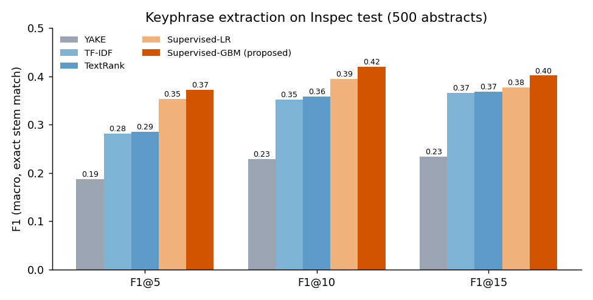
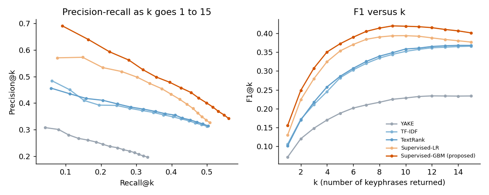
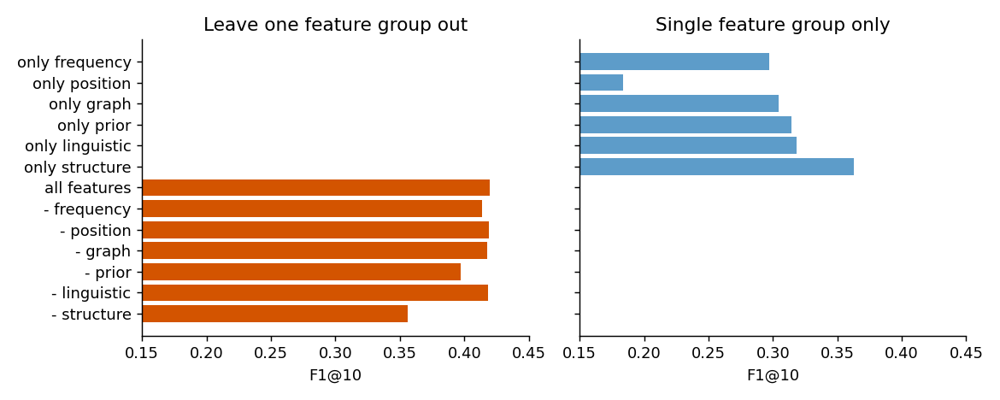
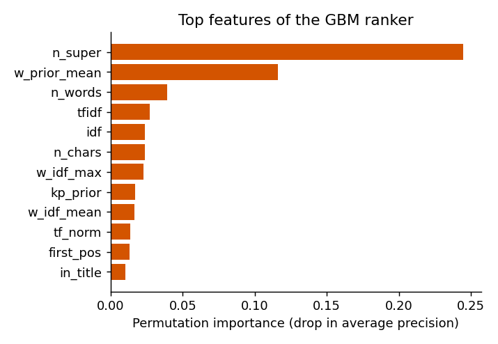
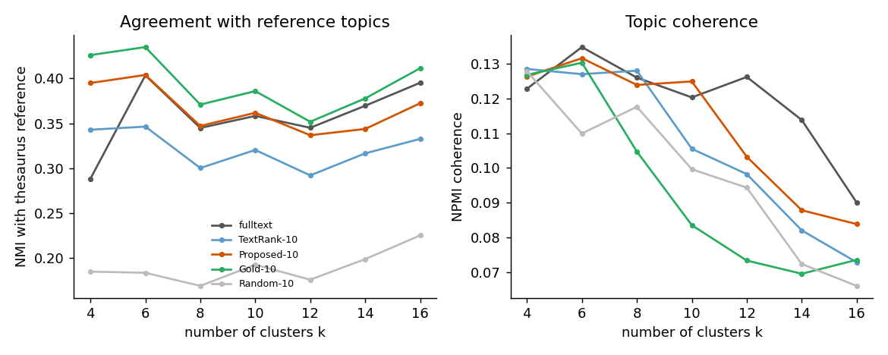
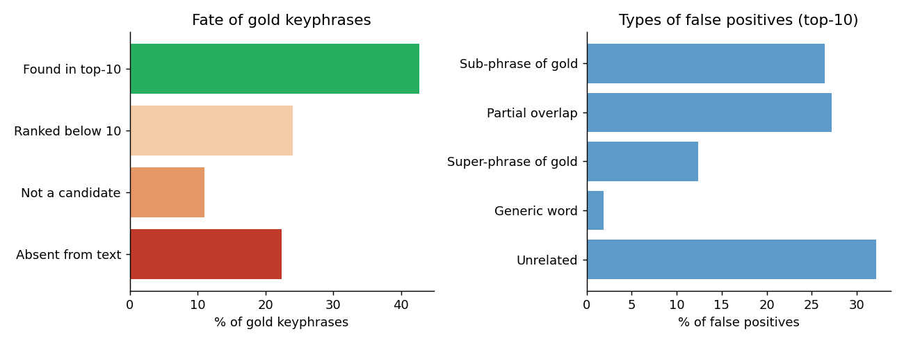

# Keyphrase Extraction and Topic-Based Organization of Research Abstracts: Unsupervised Baselines versus a Supervised Candidate Ranker

[Author name], [Enrollment number], Department of Artificial Intelligence and Data Science, [Institution]

## Abstract

Researchers face a steadily growing literature, and keyphrases are one of the most compact ways to index, search and browse it. This paper studies two connected tasks on research abstracts: (i) automatic keyphrase extraction and (ii) using the extracted keyphrases to organize a document collection into topics. On the Inspec benchmark (2,000 abstracts, 500 for testing) we compare three unsupervised baselines (TF-IDF, TextRank, YAKE) with an improved approach that ranks n-gram candidates with 28 features and a gradient boosting classifier. The proposed ranker reaches F1@10 = 0.420 and MRR = 0.803, against 0.359 and 0.640 for the best baseline (TextRank); the F1@10 gain of +0.061 (95% CI 0.050 to 0.071) is significant under a paired bootstrap. An ablation shows that structural features describing noun-phrase boundaries and corpus keyphrase priors are the most valuable. For topic organization, clustering documents by their top-10 extracted keyphrases agrees with an independent thesaurus-based reference (NMI 0.347) clearly better than TextRank keyphrases (0.300) and about as well as full-text TF-IDF (0.345), close to the gold-keyphrase oracle (0.371). Error analysis shows that 22% of gold keyphrases never appear in the abstract and that 66% of false positives are near misses of gold phrases, so exact-match scores understate practical quality. We outline research directions based on these findings.

**Keywords:** keyphrase extraction, TextRank, TF-IDF, supervised ranking, topic organization, document clustering, Inspec

## 1. Introduction

The number of scientific papers grows every year, and readers rely on short descriptors to decide what to read. Keyphrases (multi-word terms such as "feedback control" or "digital library") summarize a document, support indexing and retrieval, and can group related papers. Yet many documents have no keyphrases, and manual indexing is expensive. Automatic keyphrase extraction is therefore a long-standing NLP task, and keyphrases are a natural basis for organizing a collection by topic.

This mini project asks three questions.

* **RQ1.** On research abstracts, does a supervised candidate ranker built from simple, interpretable features outperform widely used unsupervised extractors?
* **RQ2.** Which feature families contribute most to its performance?
* **RQ3.** Can a few extracted keyphrases per document organize a collection into topics as well as the full text, and how far are they from gold keyphrases?

The contributions are: a complete reproducible pipeline (preprocessing, candidate generation, five extractors, evaluation, ablation, significance testing); a topic-organization study with an independent reference built from controlled-vocabulary terms; a detailed error analysis; and a research direction grounded in the measured failure modes.

## 2. Related Work

**Unsupervised extraction.** Frequency-based scoring such as TF-IDF is the standard baseline. RAKE (Rose et al., 2010) scores phrases by word co-occurrence statistics. TextRank (Mihalcea and Tarau, 2004) runs PageRank on a word co-occurrence graph. YAKE (Campos et al., 2020) combines local statistical features such as casing, position and dispersion. EmbedRank (Bennani-Smires et al., 2018) ranks candidates by embedding similarity with the document. Surveys are given by Hasan and Ng (2014), and the pke toolkit by Boudin (2016) implements many of these methods.

**Supervised extraction.** KEA (Witten et al., 1999) and Turney (2000) cast extraction as classification of candidate phrases with features such as TF-IDF and first position. Hulth (2003), who created the Inspec dataset, added linguistic knowledge (POS patterns). Maui (Medelyan et al., 2009) added thesaurus-based features. Neural sequence-to-sequence models can also generate keyphrases that are absent from the text (Meng et al., 2017).

**Topic organization.** Documents can be organized with latent semantic analysis (Deerwester et al., 1990), non-negative matrix factorization (Lee and Seung, 1999) or clustering such as K-Means (Lloyd, 1982). Topic quality is assessed with external agreement measures (NMI, ARI), internal measures (silhouette, Davies-Bouldin) and coherence (Roder et al., 2015).

This work follows the transparent feature-based line (candidate ranking), compares it against the common unsupervised methods under one protocol, and additionally evaluates how useful the extracted keyphrases are for organizing a collection.

## 3. Problem Definition

Given an abstract *d* (a sequence of tokens), the keyphrase extraction task returns a ranked list of phrases *K(d) = (k1, k2, ...)* such that the top-*k* phrases match the gold keyphrases *G(d)* assigned by human indexers. The topic organization task takes a collection *D* with extracted keyphrases and assigns each document to one of *m* topics so that documents within a topic are similar and each topic can be described by readable keyphrase terms.

## 4. Dataset

We use **Inspec** (Hulth, 2003), distributed in the CoreNLP-processed form of the ake-datasets repository (github.com/boudinfl/ake-datasets). It contains abstracts of journal papers in computing and control, with the title as first sentence, tokens, lemmas and Penn Treebank POS tags, and keyphrases assigned by professional indexers (free terms). The official train/dev/test split is used.

**Table 1. Dataset characteristics.**

| Property | Train | Dev | Test |
|---|---|---|---|
| Documents | 1,000 | 500 | 500 |
| Average tokens per abstract | 141.5 | 132.6 | 134.6 |
| Average sentences | 6.47 | 6.08 | 6.18 |
| Gold keyphrases (total) | 9,788 | 4,575 | 4,913 |
| Gold keyphrases per document | 9.79 | 9.15 | 9.83 |
| Average words per gold keyphrase | 2.33 | 2.34 | 2.33 |
| Gold with 1 / 2 / 3 / 4+ words (%) | 13.7 / 51.7 / 25.4 / 9.1 | 14.6 / 49.6 / 26.2 / 9.6 | 13.5 / 52.7 / 24.9 / 9.0 |
| Gold present in the abstract (%) | 77.3 | 77.3 | 78.0 |
| Candidate recall, noun-phrase mode (%) | 58.3 | 59.1 | 61.1 |
| Candidate recall, n-gram mode (%) | 65.9 | 65.8 | 67.5 |
| Average n-gram candidates per document | 50.5 | 46.8 | 48.2 |

Two properties shape every result below. First, only about 78% of gold keyphrases occur literally in the abstract, so an extractive method cannot exceed a recall of about 0.78. Second, even with the better candidate generator only 67.5% of gold phrases are candidates, because indexers use sub-spans, reorderings and phrases outside simple POS patterns. The Inspec thesaurus terms (about 4.5 per abstract) are also provided; they are never used by an extractor and serve only as an independent reference for the topic study in Section 7.4.

## 5. Methodology

### 5.1 Preprocessing and candidate generation

Tokens, lemmas and POS tags come with the data (produced by Stanford CoreNLP, Manning et al., 2014). We keep tokens tagged as adjectives or nouns that are alphabetic, longer than one character and not in the scikit-learn English stop-word list, group consecutive such tokens within a sentence into chunks, and trim each chunk so that it ends with a noun. Two generators are used. **Noun-phrase (np) mode** keeps the longest phrase of each chunk (at most 5 words). **N-gram mode** keeps every contiguous span of 1 to 4 words ending with a noun. Phrases are lower-cased and every word is Porter-stemmed (Porter, 1980) so that "recurring issues" and "recur issu" match. Matching is exact on stemmed phrases, and a gold keyphrase may list several accepted variants.

### 5.2 Baselines

* **TF-IDF.** Score = log(1 + tf) x idf, where tf is the phrase frequency in the abstract and idf is computed from the document frequency of the phrase in the training abstracts.
* **TextRank.** A graph over the stems of eligible words is built with an edge between words within a sliding window; PageRank (damping 0.85) gives word scores, and a phrase scores the sum of its word scores.
* **YAKE.** The yake library with default settings (phrases up to 3 words, deduplication threshold 0.9).

The candidate mode, window size and score aggregation were selected on the dev split (Section 6).

### 5.3 Improved approach: supervised candidate ranking

Every n-gram candidate of a document is one example, labelled positive if it matches a gold keyphrase. It is described by 28 features in six groups (Table 2). A classifier estimates the probability of being a keyphrase and candidates are ranked by it. We train a logistic regression (LR) and a histogram-based gradient boosting classifier (GBM), both from scikit-learn (Pedregosa et al., 2011). Corpus statistics used by the idf and prior features are computed out-of-fold on training documents (5 folds), so that the statistics of a document never include its own labels.

**Table 2. Feature groups of the supervised ranker.**

| Group | Features | Intuition |
|---|---|---|
| Frequency | tf, log tf, normalized tf, idf, tf-idf, mean and max word idf | important terms are repeated but not ubiquitous |
| Position | first and last occurrence, spread, in title, fraction of sentences containing it | keyphrases appear early, in the title, across the text |
| Graph | sum, mean, max of TextRank word scores | central words in the co-occurrence graph |
| Prior | phrase keyphrase-ness, seen in training, mean and max word keyphrase-ness | phrases or words that were keyphrases elsewhere |
| Linguistic | number of words and characters, hyphen, plural head, adjective start, document length | length and form preferences of indexers |
| Structure | number of longer candidates containing the phrase (n_super), number of shorter candidates inside it (n_sub) | tells whether the phrase is a complete noun phrase or a fragment |

### 5.4 Redundancy filter

Because many candidates overlap ("neural network", "neural network model"), a greedy filter removes a phrase whose word-set Jaccard similarity with a higher ranked kept phrase exceeds a threshold (1.0 disables the filter). The threshold is tuned on dev for every system.

### 5.5 Topic-based organization

Each test document is represented by TF-IDF over its top-10 keyphrases (whole phrases and their words). We compare five representations: full-text TF-IDF (unigrams and bigrams), TextRank top-10, proposed top-10, gold top-10 (oracle), and 10 random candidates (lower bound). Two algorithms group the documents: K-Means on a 50-dimensional LSA space, and NMF with argmax assignment. The main setting is k = 8 and a sweep over k = 4 to 16 is also reported. Topics are described by keyphrase words ranked by frequency times lift, and written to a topic index.

## 6. Experimental Setup

**Protocol.** Hyper-parameters are chosen on dev with corpus statistics from train only. Final models use train+dev and are scored once on test. Grids: TF-IDF candidate mode; TextRank mode (np, n-gram), window (3, 6, 10), aggregation (sum, mean); LR C (0.1, 1); GBM learning rate (0.05, 0.1), depth (3, 5), iterations (100, 300); redundancy threshold (1.0, 0.6, 0.4). Selected: TF-IDF np; TextRank np, window 3, sum; YAKE overlap 0.4; LR C = 0.1 with overlap 0.4; GBM learning rate 0.1, depth 3, 300 iterations, no filter.

**Keyphrase metrics.** Precision, recall and F1 at k = 5, 10, 15, macro-averaged over documents, where a gold keyphrase counts as found when any of its stemmed variants is in the top-k. We also report mean reciprocal rank (MRR) and MAP@15. Significance uses a paired bootstrap over documents with 10,000 resamples (Koehn, 2004).

**Topic metrics.** Extrinsic: NMI, ARI and V-measure against a reference grouping obtained by K-Means (same k) on the TF-IDF of the Inspec controlled-thesaurus terms. Intrinsic: silhouette (cosine), Davies-Bouldin index, and NPMI coherence of the top-10 full-text words of each cluster computed over document co-occurrence. Values are means over 5 seeds.

## 7. Results

### 7.1 Keyphrase extraction

**Table 3. Keyphrase extraction results on the Inspec test split (500 abstracts).**

| System | P@5 | R@5 | F1@5 | P@10 | R@10 | F1@10 | P@15 | R@15 | F1@15 | MRR | MAP@15 |
|---|---|---|---|---|---|---|---|---|---|---|---|
| YAKE | 0.261 | 0.162 | 0.188 | 0.225 | 0.264 | 0.228 | 0.197 | 0.332 | 0.234 | 0.496 | 0.165 |
| TF-IDF | 0.391 | 0.244 | 0.282 | 0.348 | 0.404 | 0.353 | 0.313 | 0.501 | 0.366 | 0.641 | 0.292 |
| TextRank | 0.397 | 0.247 | 0.286 | 0.355 | 0.410 | 0.359 | 0.314 | 0.504 | 0.368 | 0.640 | 0.292 |
| Supervised-LR | 0.497 | 0.303 | 0.354 | 0.396 | 0.443 | 0.394 | 0.326 | 0.508 | 0.377 | 0.726 | 0.355 |
| **Supervised-GBM (proposed)** | **0.525** | **0.319** | **0.373** | **0.419** | **0.477** | **0.420** | **0.342** | **0.562** | **0.402** | **0.803** | **0.402** |

The proposed GBM ranker is best on every metric. At k = 10 it improves F1 by 0.061 over TextRank and by 0.067 over TF-IDF, and its MRR of 0.803 means that the first correct keyphrase is usually found at rank 1 or 2. The two classical baselines are close to each other, and YAKE with default parameters is clearly weaker on this exact-match protocol (it was only tuned for the redundancy threshold). A logistic regression on the same features already beats all unsupervised methods (F1@10 = 0.394), and the non-linear GBM adds a further 0.025.

**Table 4. Paired bootstrap, proposed GBM minus each system (per-document F1@10, 10,000 resamples).**

| Compared with | Mean difference | 95% CI | p |
|---|---|---|---|
| TextRank | +0.061 | [0.050, 0.071] | < 0.001 |
| TF-IDF | +0.067 | [0.055, 0.079] | < 0.001 |
| YAKE | +0.191 | [0.177, 0.206] | < 0.001 |
| Supervised-LR | +0.025 | [0.018, 0.033] | < 0.001 |

All gains are statistically significant. One caveat on fairness: the supervised systems use labelled training data (1,500 abstracts) while the baselines do not, although the baselines also use the training abstracts for document frequencies and were tuned on dev.

### 7.2 Ablation and feature importance

**Table 5. Feature-group ablation of the GBM ranker (test split).**

| Setting | P@10 | R@10 | F1@10 | MRR |
|---|---|---|---|---|
| All features | 0.419 | 0.477 | 0.420 | 0.803 |
| minus frequency | 0.413 | 0.469 | 0.414 | 0.786 |
| minus position | 0.418 | 0.477 | 0.419 | 0.793 |
| minus graph | 0.417 | 0.476 | 0.418 | 0.801 |
| minus prior | 0.396 | 0.451 | 0.397 | 0.773 |
| minus linguistic | 0.419 | 0.476 | 0.419 | 0.781 |
| minus structure | 0.349 | 0.413 | 0.356 | 0.702 |
| only frequency | 0.288 | 0.350 | 0.297 | 0.603 |
| only position | 0.177 | 0.220 | 0.184 | 0.443 |
| only graph | 0.297 | 0.354 | 0.304 | 0.568 |
| only prior | 0.305 | 0.370 | 0.314 | 0.592 |
| only linguistic | 0.311 | 0.371 | 0.318 | 0.593 |
| only structure | 0.363 | 0.413 | 0.363 | 0.654 |

Removing the **structure** features costs the most (F1@10 falls from 0.420 to 0.356), followed by the **prior** features (to 0.397). The structure group alone (0.363) already beats TF-IDF (0.353). The reason is that n_super identifies maximal noun phrases: a candidate that is not contained in a longer candidate is more likely to be a complete phrase, whereas indexers mostly choose complete noun phrases and n-gram candidates contain many fragments. The structure features thus act as a learned boundary detector. Permutation importance agrees: n_super (0.245 drop in average precision) and mean word keyphrase-ness (0.116) are the two strongest features, far ahead of tf-idf (0.027). Position matters little here (F1@10 changes by less than 0.001 when it is removed), plausibly because abstracts are short and the title is already used. 

The redundancy filter did not help the GBM on dev (selected threshold 1.0), but it helped YAKE and LR.

### 7.3 Topic-based organization

**Table 6. Clustering of the 500 test abstracts into k = 8 topics (mean over 5 seeds). Higher is better except Davies-Bouldin (DB).**

| Representation | Algorithm | NMI | ARI | Silhouette | DB | NPMI |
|---|---|---|---|---|---|---|
| Full text | K-Means | 0.345 | 0.209 | 0.086 | 3.86 | 0.126 |
| Full text | NMF | 0.350 | 0.215 | 0.684 | 0.73 | 0.127 |
| TextRank top-10 | K-Means | 0.300 | 0.168 | 0.101 | 3.78 | 0.128 |
| TextRank top-10 | NMF | 0.285 | 0.160 | 0.640 | 0.75 | 0.122 |
| **Proposed top-10** | K-Means | 0.347 | 0.204 | 0.098 | 3.79 | 0.124 |
| **Proposed top-10** | NMF | 0.344 | 0.217 | 0.655 | 0.72 | 0.134 |
| Gold top-10 (oracle) | K-Means | 0.371 | 0.216 | 0.102 | 3.70 | 0.105 |
| Gold top-10 (oracle) | NMF | 0.393 | 0.250 | 0.684 | 0.69 | 0.113 |
| Random top-10 (lower bound) | K-Means | 0.169 | 0.087 | 0.073 | 4.05 | 0.118 |
| Random top-10 (lower bound) | NMF | 0.171 | 0.104 | 0.611 | 0.81 | 0.121 |

Agreement with the reference topics orders the representations as expected: random (0.17) < TextRank keyphrases (0.30) < proposed keyphrases (0.35) < gold keyphrases (0.37 to 0.39). Better extraction therefore translates into better organization. The proposed keyphrases match full-text TF-IDF (0.347 against 0.345 with K-Means) while describing each document with only 10 phrases, which makes the grouping smaller and directly interpretable. Silhouette values of K-Means are low (about 0.09 to 0.10), which means topics overlap in short abstracts; NMF silhouettes are computed in the factor space and cannot be compared with those of K-Means. NPMI coherence differs little between representations (0.12 to 0.13), so it does not discriminate well here, and the gold oracle has lower coherence because its keyphrases contain many rare, specific terms.

The sweep over k confirms the ordering: the proposed keyphrases beat TextRank keyphrases for every k (NMI 0.395 against 0.343 at k = 4, 0.372 against 0.333 at k = 16). Against full text the result depends on k: the keyphrases are better at k = 4 (0.395 against 0.288), equal at k = 6 to 10, and 0.01 to 0.03 lower for k = 12 to 16, so for finer topic structure the full text keeps some advantage.

**Topic index.** The pipeline writes a readable index of the collection (`results/topic_index.md`). Examples for k = 8 with the proposed keyphrases:

* Topic 4 (64 documents), label words *control, scheme, feedback, power*; keyphrases include optimal control, feedback control, PID controller; documents on adaptive state feedback and sliding mode control.
* Topic 6 (49 documents), *image, camera, color, geometrical*; keyphrases include panoramic image mosaics and computational color constancy algorithms.
* Topic 7 (48 documents), *web, internet, site, web-based*; keyphrases include web sites, web server, bilingual web site.
* Topic 8 (41 documents), *library, electronic, collections, publishing*; keyphrases include academic libraries, digital library, scholarly publishing.

Topics 1 (time, process, data) and 5 (function, linear, problem) are broad mixtures, which shows the limit of eight clusters on a heterogeneous collection.

## 8. Error Analysis

All numbers refer to the proposed system, top-10, on the test split (4,913 gold keyphrases, 4,997 predictions).

**Table 7. What happens to the gold keyphrases.**

| Fate of a gold keyphrase | Count | Share |
|---|---|---|
| Found in the top-10 | 2,096 | 42.7% |
| Candidate generated but ranked below 10 | 1,180 | 24.0% |
| In the text but not generated as a candidate | 539 | 11.0% |
| Absent from the abstract text | 1,098 | 22.4% |

Of the 77.6% of gold keyphrases that appear in the text, 54.9% are in the top-10. The largest recoverable loss is ranking (24.0%), followed by candidate generation (11.0%). The 22.4% absent phrases cannot be found by any extractive method.

**Table 8. Types of false positives (2,908 top-10 predictions that are not exact matches).**

| Type | Count | Share |
|---|---|---|
| Sub-phrase of a gold keyphrase | 769 | 26.4% |
| Partial word overlap with a gold keyphrase | 790 | 27.2% |
| Super-phrase of a gold keyphrase | 361 | 12.4% |
| Generic frequent single word | 54 | 1.9% |
| Unrelated to any gold keyphrase | 934 | 32.1% |

Two thirds (66.0%) of the false positives share words with a gold keyphrase. They are boundary errors and near misses such as a truncated or over-extended phrase, not wrong topics, and exact match gives them no credit. Generic words are rare (1.9%) because the idf and prior features suppress them.

**By phrase length.** The share of gold keyphrases found in the top-10 is 21.8% for one-word phrases, 49.9% for two words, 47.0% for three words and 19.4% for four or more words. Short generic terms such as "throughput" or "security" compete with many fragments, and long phrases are limited by the 4-word candidate window and by exact reproduction of the indexer's wording.

**Table 9. F1@10 by document properties.**

| Property | Bin | Documents | F1@10 | P@10 | R@10 |
|---|---|---|---|---|---|
| Gold present in text | at most 50% | 56 | 0.226 | 0.223 | 0.264 |
| | 51 to 75% | 150 | 0.363 | 0.363 | 0.399 |
| | 76 to 99% | 176 | 0.467 | 0.512 | 0.463 |
| | 100% | 118 | 0.513 | 0.446 | 0.696 |
| Number of gold keyphrases | 1 to 5 | 97 | 0.359 | 0.256 | 0.624 |
| | 6 to 9 | 177 | 0.432 | 0.375 | 0.514 |
| | 10 to 14 | 137 | 0.448 | 0.484 | 0.420 |
| | 15 or more | 89 | 0.419 | 0.585 | 0.329 |
| Abstract length (tokens) | at most 100 | 162 | 0.412 | 0.349 | 0.553 |
| | 101 to 150 | 149 | 0.438 | 0.434 | 0.490 |
| | 151 to 200 | 121 | 0.427 | 0.466 | 0.433 |
| | over 200 | 68 | 0.383 | 0.472 | 0.342 |

Performance is driven by how much of the gold appears in the text (F1 from 0.23 to 0.51). With a fixed k = 10, documents with few gold phrases are penalized in precision and documents with many gold phrases in recall, and very long abstracts are harder.

**Complementarity.** Of all gold keyphrases, 1,419 are found by both the proposed system and TextRank, 677 only by the proposed system, 336 only by TextRank, and 2,481 by neither. The union would reach a recall at 10 of 49.5%, against 42.7% for the proposed system alone, so a hybrid could still gain up to about 7 points (an oracle bound, not an achievable figure).

**Qualitative examples** (full list in `results/error_examples.md`).

* *Doc 196, "On the emergence of rules in neural networks" (F1@10 = 0).* The gold keyphrase "abstract rules" is replaced by "factor abstract rules", an over-extended phrase, and the gold "neural network" does not reach the top-10, which is dominated by longer phrases. This is a boundary error.
* *Doc 338, "Down up [IT projects]" (F1@10 = 0).* All seven gold keyphrases (for example company names such as Ford and Caterpillar) are absent from the abstract, so no extractive method can succeed.
* *Doc 371, "A better ballot box?" (F1@10 = 0).* The gold "online voting" is predicted as "voting online", the same concept with a different word order that exact match rejects; three of the six gold phrases are absent from the text.
* *Doc 228, polymerase chain reaction and gel electrophoresis.* The predictions "microwell polymerase chain reaction" and "subsequent ultrathin-layer gel electrophoresis" miss the gold wording "rapid microwell polymerase chain reaction" and "ultrathin-layer gel electrophoresis" by one word each; only "large-scale genotyping" counts as a hit.

## 9. Discussion and Limitations

**Answers to the research questions.** (RQ1) Yes: a feature-based ranker improves F1@10 from 0.359 to 0.420 over the best baseline and improves MRR from 0.640 to 0.803, and the gain is significant. (RQ2) Structural and corpus-prior features matter most, frequency features moderately, and position and graph features little on short abstracts. (RQ3) Ten extracted keyphrases organize the collection about as well as the full text and clearly better than TextRank keyphrases, with a small gap to the gold-keyphrase oracle at k = 8.

**Limitations.** (1) One dataset, one domain (computing and control abstracts) and one language; the supervised model needs labelled data and may not transfer to full papers or other fields. (2) Exact stem matching under-credits near misses, so reported scores understate practical usefulness; no human evaluation was done. (3) The topic reference is derived from only about 4.5 thesaurus terms per abstract and is itself an approximation of true topics; k = 8 was fixed a priori. (4) No neural or embedding-based baselines were run, because the project uses only CPU and no pre-trained models. (5) YAKE was run with default parameters and may be under-tuned. (6) The n_super feature depends on the candidate generator, so the result cannot be assumed for other generators.

## 10. Conclusion and Future Work

We built and evaluated a complete pipeline for keyphrase extraction and topic-based organization of research abstracts. A supervised GBM candidate ranker with interpretable features beat TF-IDF, TextRank and YAKE significantly (F1@10 = 0.420), the extracted keyphrases organized the collection into topics at a quality close to full text and to gold keyphrases, and an error analysis located the remaining loss.

**Research directions suggested by the findings.**

1. *Boundary-aware extraction.* Two thirds of false positives are near misses and 11% of gold phrases are lost in candidate generation. Learning span boundaries (sequence labelling or a ranker trained with partial-match rewards) and evaluating with partial-credit metrics should recover much of this loss.
2. *Hybrid statistical and graph signals.* The oracle union of TextRank and the proposed system raises recall at 10 from 42.7% to 49.5%, which motivates learning when to trust each signal.
3. *Absent keyphrases.* 22.4% of gold phrases are not in the text. Generation models or linking to a controlled vocabulary could address them.
4. *Semantic representations.* Sentence embeddings for candidate scoring and for clustering keyphrases (merging "online voting" and "voting online") would tackle paraphrase mismatches and may improve fine-grained topics where full text still leads.
5. *Joint modelling and generalization.* Keyphrase-aware topic models, evaluation on SemEval-2010 and KP20k, and human evaluation of topic labels.

## References

1. Bennani-Smires, K., Musat, C., Hossmann, A., Baeriswyl, M., Jaggi, M. (2018). Simple unsupervised keyphrase extraction using sentence embeddings. CoNLL.
2. Boudin, F. (2016). pke: an open source python-based keyphrase extraction toolkit. COLING (demonstrations).
3. Campos, R., Mangaravite, V., Pasquali, A., Jorge, A., Nunes, C., Jatowt, A. (2020). YAKE! Keyword extraction from single documents using multiple local features. Information Sciences, 509, 257-289.
4. Deerwester, S., Dumais, S. T., Furnas, G. W., Landauer, T. K., Harshman, R. (1990). Indexing by latent semantic analysis. JASIS, 41(6), 391-407.
5. Hasan, K. S., Ng, V. (2014). Automatic keyphrase extraction: a survey of the state of the art. ACL.
6. Hulth, A. (2003). Improved automatic keyword extraction given more linguistic knowledge. EMNLP.
7. Koehn, P. (2004). Statistical significance tests for machine translation evaluation. EMNLP.
8. Lee, D. D., Seung, H. S. (1999). Learning the parts of objects by non-negative matrix factorization. Nature, 401, 788-791.
9. Lloyd, S. (1982). Least squares quantization in PCM. IEEE Transactions on Information Theory, 28(2), 129-137.
10. Medelyan, O., Frank, E., Witten, I. H. (2009). Human-competitive tagging using automatic keyphrase extraction. EMNLP.
11. Meng, R., Zhao, S., Han, S., He, D., Brusilovsky, P., Chi, Y. (2017). Deep keyphrase generation. ACL.
12. Mihalcea, R., Tarau, P. (2004). TextRank: bringing order into texts. EMNLP.
13. Pedregosa, F. et al. (2011). Scikit-learn: machine learning in Python. JMLR, 12, 2825-2830.
14. Roder, M., Both, A., Hinneburg, A. (2015). Exploring the space of topic coherence measures. WSDM.
15. Rose, S., Engel, D., Cramer, N., Cowley, W. (2010). Automatic keyword extraction from individual documents. In Text Mining: Applications and Theory, Wiley.
16. Turney, P. D. (2000). Learning algorithms for keyphrase extraction. Information Retrieval, 2(4), 303-336.
17. Witten, I. H., Paynter, G. W., Frank, E., Gutwin, C., Nevill-Manning, C. G. (1999). KEA: practical automatic keyphrase extraction. ACM Digital Libraries.
18. Manning, C. D. et al. (2014). The Stanford CoreNLP natural language processing toolkit. ACL (system demonstrations).
19. Porter, M. F. (1980). An algorithm for suffix stripping. Program, 14(3), 130-137.

## Appendix A. Reproducibility

Code, data download script, logs and all result files are in the project folder. `bash run_all.sh` downloads Inspec from the ake-datasets repository and regenerates every table and figure in about five minutes on a CPU. All steps are seeded and were verified to give identical results across Python hash seeds. See `README.md`.
